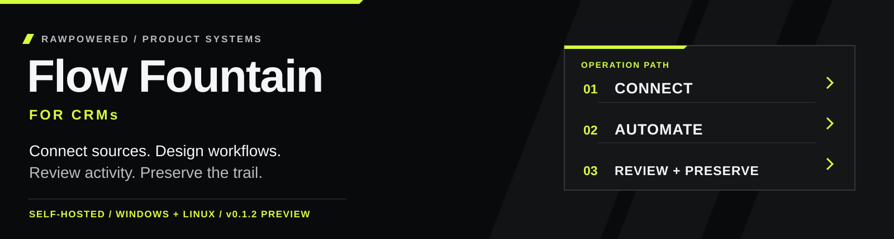
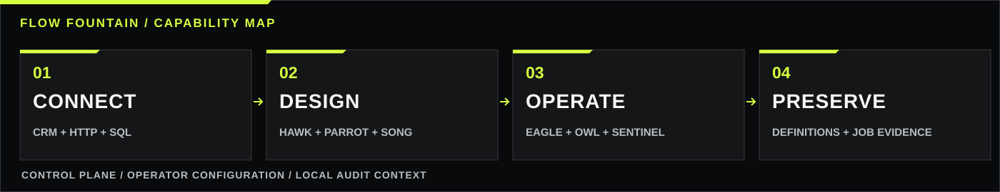
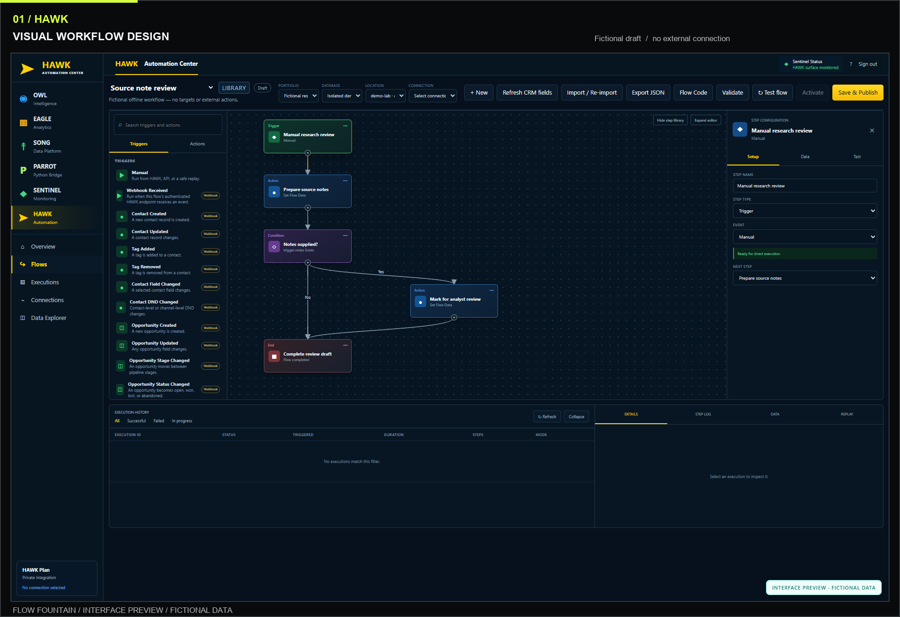
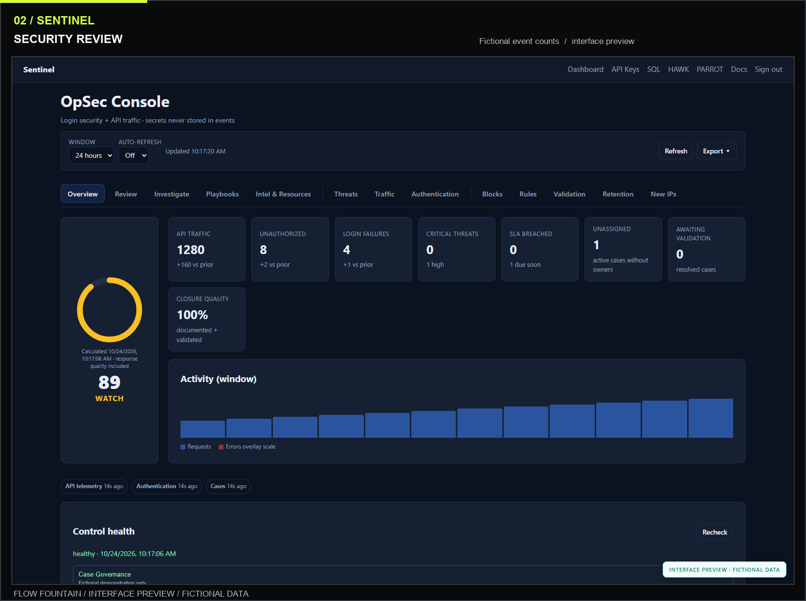
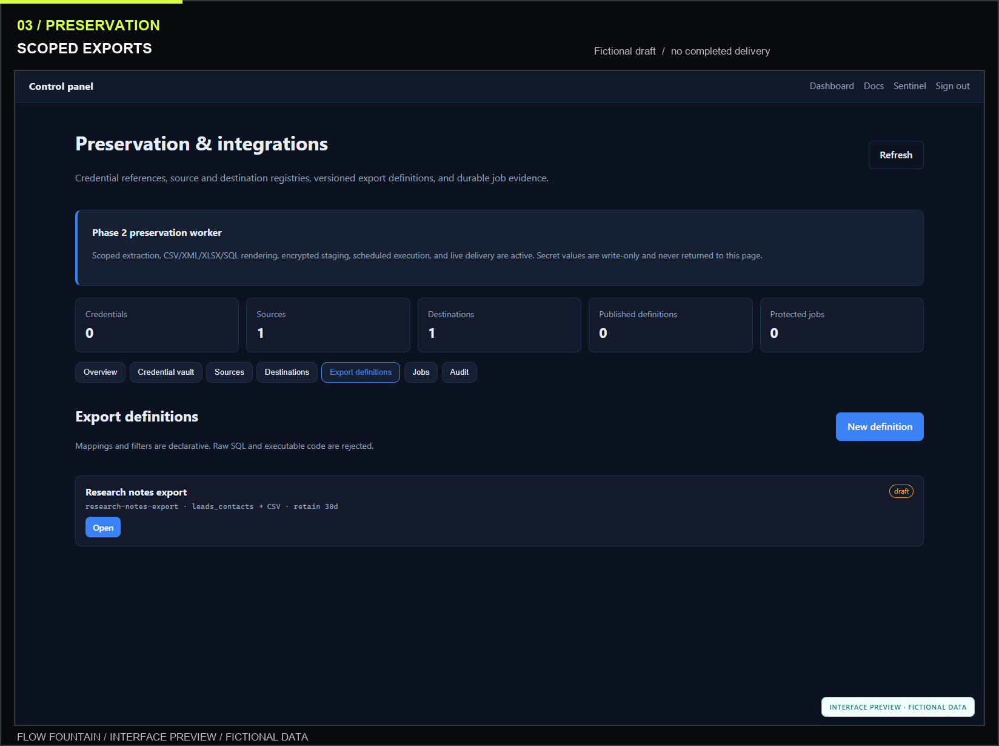
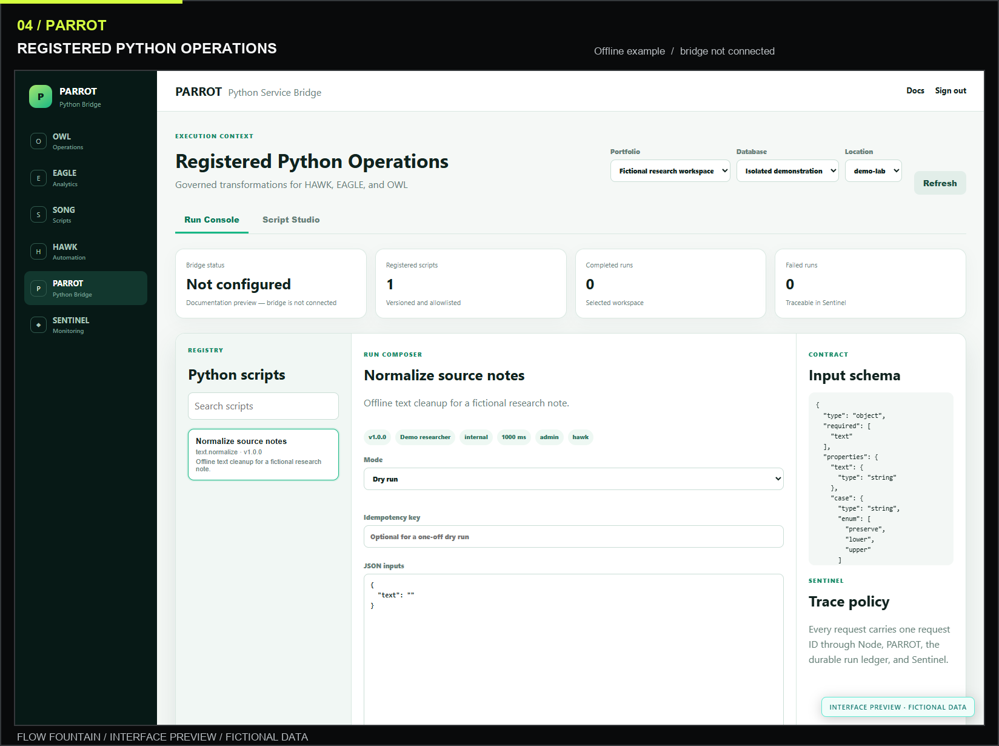
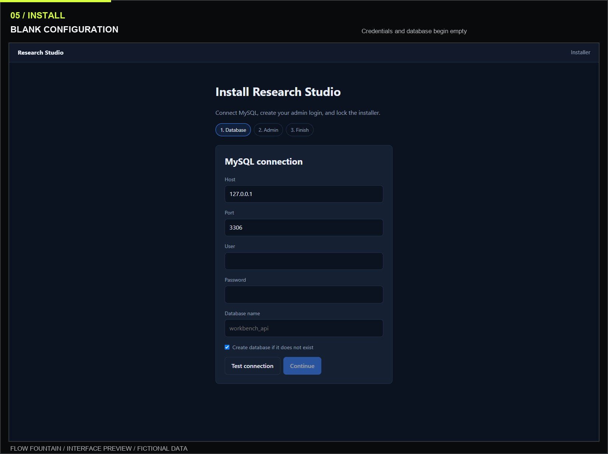
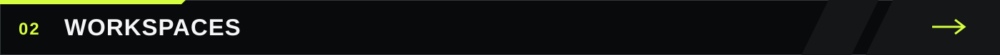
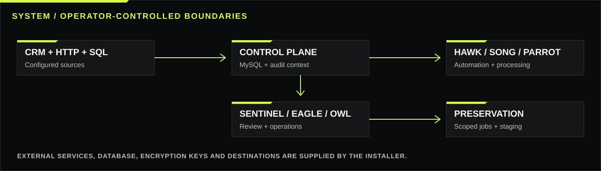

<div align="center">



<h1 align="center">Flow Fountain for CRMs</h1>

**Connect sources. Design workflows. Review activity. Preserve the trail.**

Self-hosted CRM workflows, integrations, operational analytics, and audit context.

<p align="center">
  <a href="docs/INSTALLATION.md"></a>
  <a href="LICENSE"></a>
  <a href="RELEASE_NOTES.md"></a>
  <a href="https://github.com/RawPowered/flow-fountain-for-crms/actions/workflows/ci.yml"></a>
</p>

<p align="center">
  <a href="#product-tour"></a>
  <a href="#the-workspace-at-a-glance"></a>
  <a href="#how-it-fits-together"></a>
  <a href="#quick-start"></a>
</p>

</div>



Current release: **v0.1.2 preview**. [Download the source](https://github.com/RawPowered/flow-fountain-for-crms/releases/tag/v0.1.2) · [Product and compatibility versions](docs/VERSIONING.md) · [Installation guide](docs/INSTALLATION.md).

<h2 id="give-your-crm-a-connected-workflow"></h2>

**Originally built for GoHighLevel CRM, Flow Fountain for CRMs can be adapted to any API-enabled CRM.** It combines visual workflow authoring, integration controls, operational analytics, security review, and evidence preservation in a self-hosted workspace.

GoHighLevel / LeadConnector is the original CRM integration. Adapting another CRM requires configuring or extending its authentication, API endpoints, field mappings, and webhook behavior. HTTP, SQL, and optional Python integrations provide the building blocks for that work.

Every installation begins with its own configuration: no deployment domains, credentials, customer mappings, saved targets, or searches are bundled.

| Build a workflow | Review the context | Preserve the trail |
|:---|:---|:---|
| Arrange triggers, conditions, and actions in a visual editor. Add reviewed Python processing when needed. | Inspect security events, findings, case activity, and playbooks in a dedicated console. | Define scoped exports, version the mappings, and track preservation jobs and delivery evidence. |

> [!IMPORTANT]
> **Project preview.** Source releases are available for Windows and Linux under GPL v3. Automated checks run on both platforms with Node.js 22 and 24. A full installation against a live MySQL server and external integration acceptance checks remain unverified. Read the [release notes](RELEASE_NOTES.md) before deployment.

<h2 id="product-tour"></h2>

These browser captures show the Flow Fountain for CRMs interface. The workspace screens use an isolated preview with **fictional data and mocked API responses**: they illustrate the interface rather than completed live operations. The installer capture shows the blank setup screen. Preview records and illustration assets do not configure a fresh installation.

### Design the steps before you run them

HAWK provides a visual workspace for triggers, conditions, actions, and execution review. This fictional note-review draft uses manual input and local flow data; it has no search target or external connection.

<p align="center">
  <a href="docs/assets/screenshots/workflow-designer.png"></a>
</p>

### Focused workspaces for the rest of the process

<table>
  <tr>
    <td width="50%" valign="top"><strong>Review security and case context</strong><br><sub>SENTINEL brings event activity, response priorities, and control health into one view.</sub><br><br><a href="docs/assets/screenshots/sentinel-overview.png"></a></td>
    <td width="50%" valign="top"><strong>Prepare a preservation definition</strong><br><sub>Register sources and destinations, define exports, and follow job evidence.</sub><br><br><a href="docs/assets/screenshots/evidence-preservation.png"></a></td>
  </tr>
  <tr>
    <td width="50%" valign="top"><strong>Compose reviewed Python operations</strong><br><sub>PARROT exposes registered handlers, input contracts, dry-run controls, and run history.</sub><br><br><a href="docs/assets/screenshots/python-console.png"></a></td>
    <td width="50%" valign="top"><strong>Start with your own configuration</strong><br><sub>The installer asks for your database and administrator account. Connection credentials begin empty.</sub><br><br><a href="docs/assets/screenshots/blank-installation.png"></a></td>
  </tr>
</table>

<p align="center"><sub>Click any image to inspect it at full size. Workspace captures contain fictional demonstration data. <a href="docs/SCREENSHOTS.md">Screenshot provenance and privacy review</a>.</sub></p>

<h2 id="the-workspace-at-a-glance"></h2>

| Workspace | Purpose |
|:---|:---|
| **SENTINEL** | Security event review, findings, investigation cases, playbooks, and audit context. |
| **Preservation** | Source and destination registries, versioned export definitions, encrypted staging, and job records. |
| **HAWK** | Visual automation authoring with conditions, actions, dry runs, and execution history. |
| **PARROT** | Optional Python bridge for registered handlers and reviewed, versioned processing scripts. |
| **EAGLE** | CRM and operational analytics, geographic views, and reporting. |
| **OWL** | Scoped operational records, queues, users, assignments, and scheduling. |
| **SONG** | Conditional script authoring, publishing, version selection, and runtime events. |
| **Integration controls** | Operator-configured SQL, HTTP, and CRM connections with scoped grants and credential references. |

The modules are available as building blocks. Enable and configure the parts that fit your CRM and operational process.

<h2 id="how-it-fits-together"></h2>



The diagram shows source relationships and operator-controlled boundaries. Each installation supplies its own external services, database, encryption keys, and destinations.

Public provider addresses remain in adapters where their protocols or allowlists require them. Each user supplies their own integration configuration and credentials. See the [architecture notes](content/docs/architecture.md) and [installation guide](docs/INSTALLATION.md).

<h2 id="quick-start"></h2>

**You will need:** Windows or Linux, Node.js 22 or 24, and a running MySQL 8 database. Python 3.12+ is optional for the Python bridge. Download the source ZIP from the [releases page](https://github.com/RawPowered/flow-fountain-for-crms/releases) and extract it first.

### Windows · PowerShell

```powershell
npm.cmd ci
Copy-Item .env.example .env
npm.cmd start
```

Or run `./start.ps1` from the extracted directory.

### Linux · Terminal

```sh
npm ci
umask 077
cp .env.example .env
npm start
```

Or run `sh start.sh` from the extracted directory.

Open **http://127.0.0.1:3000/install**, enter your database settings, and create your administrator account. Save the generated login address and restart after installation. The application binds to your computer's loopback interface by default.

[Read the complete setup and server deployment guide →](docs/INSTALLATION.md)

<h2 id="start-blank-configure-deliberately"></h2>

- Installation identity, administrator access, and encryption keys are generated locally.
- External connections, custom field mappings, research targets, and allowed network hosts start unconfigured.
- Documentation artwork and screenshot fixtures are separate from application settings.
- Runtime configuration, dependencies, logs, and local evidence are excluded from the release file list.
- Release checks scan approved source files; documentation PNGs must match explicitly reviewed file hashes.

For an HTTPS server deployment, configure production mode, secure cookies, the proxy boundary, and browser origins for your own environment. Keep `.env` and runtime evidence private. The [installation guide](docs/INSTALLATION.md) covers these settings.

<h2 id="documentation-and-project-status"></h2>

| Start here | Explore further |
|:---|:---|
| [Installation and operations](docs/INSTALLATION.md) | [Module and API documentation](content/docs/index.md) |
| [Release notes and current limitations](RELEASE_NOTES.md) | [Optional Python bridge](parrot/README.md) |
| [Screenshot provenance](docs/SCREENSHOTS.md) | [Third-party notices](THIRD_PARTY_NOTICES.md) |
| [GPL v3 license](LICENSE) | [Windows and Linux checks](https://github.com/RawPowered/flow-fountain-for-crms/actions) |

To validate a checkout:

```sh
npm test
npm run test:python
npm run release:check
npm run release:pack
```

Use Flow Fountain for CRMs with data and systems you are authorized to access. Public issues should describe reproducible behavior without including credentials, personal records, or private evidence.

---

<p align="center"><br><strong>Flow Fountain for CRMs</strong><br><sub>Your CRM. Your workflows. Your configuration.</sub><br><a href="https://github.com/RawPowered"></a></p>
